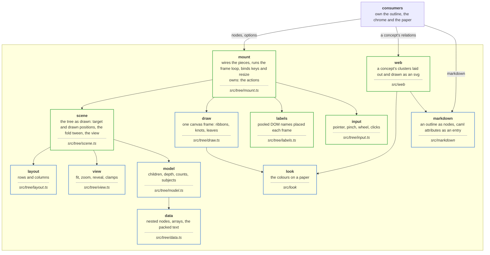

# markgraphs

[](https://github.com/wikibonsai/wikibonsai)
[](https://underhood-badge.netlify.app)
[](https://npmjs.org/package/@wikibonsai/markgraphs)

Graphs from markdown: a tree from an outline, and a web from a concept's attributes, worn in one look. Each lives on its own subpath, with no framework:

- **`/tree`**: an interactive tree. A canvas draws the wood, knots and leaves; the names are real text in the DOM over it, pooled and placed each frame, so a tree of twenty thousand concepts moves at frame rate. Folding, fit, zoom, pan, pinch, keyboard walking, a fold tween, reduced motion and a dark and a light paper are all inside. It takes nodes, not markdown.
- **`/web`**: a concept at the core, the concepts it relates to in clusters round it, as an svg.
- **`/markdown`**: the outline and the [caml](https://github.com/wikibonsai/caml) attributes as the data the other two draw. The only subpath with a runtime dependency.
- **`/look`**: the colours both wear on a dark and a light paper.

🗺️ Draw the graphs of a [🎋 WikiBonsai](https://github.com/wikibonsai/wikibonsai) garden.

## Install

Install with [npm](https://docs.npmjs.com/cli/v9/commands/npm-install):

```bash
$ npm install @wikibonsai/markgraphs
```

## Use

```ts
import * as markdown from '@wikibonsai/markgraphs/markdown';
import * as tree from '@wikibonsai/markgraphs/tree';
import * as web from '@wikibonsai/markgraphs/web';

const outline: markdown.OutlineNode | null = markdown.readTree('- [[plant]]\n  - [[root]]\n  - [[stem]]\n    - [[leaf]]');
if (outline !== null) {
  const plants: tree.TreeMount = tree.mountTree(treeHost, outline, {
    paper: 'light',
    onPick: (i: number): void => console.log(plants.model.names[i]),
  });
  plants.expandAll();
}

const entry: markdown.Entry = markdown.readEntry(': title :: plant\n: hyponym :: [[moss]], [[fern]]\n');
web.mountWeb(webHost, entry, { paper: 'light' });
```

The tree's host is any positioned element: the mount fills it with a canvas and a label layer and sizes them to it.

## Tree behavior

- The tree grows rightward: a row to each leaf and folded branch, a column to each depth, a branch centred on its children. Branches are ribbons as thick as what they hold (`1.8 + 7.2 * sqrt(n / max(43, total / 4.6))`), knots are hollow open and filled folded with a `+n` badge, leaves are coins (squares when a squeezed tree is zoomed far out).
- `root: 'show'` draws the root as the first knot, 17px and bold, in the bark colour with its branches blending from bark into their band; a lone root is a green leaf. `root: 'hide'` draws no root: its children are limbs that start at an edge the host supplies (`edge`), each limb block spaced down the side. A host draws the trunk itself with `behind` and `front` on the same canvas.
- A knot's click folds or unfolds; a name's click picks (`onPick`); a double click on a name folds. A drag that moved does not click. The clicked branch stays where it was on screen through the fold; newcomers grow out of their nearest drawn ancestor and leavers fold into theirs. Under `reducedMotion` folds and glides land at once.
- Opens fitted. With `refit`, the fit is kept after a fold or a resize until the view is moved by hand. With `foldUnder`, a tree whose width would be under that scale to fit opens with only the root open. With `rows`, rows spread to fill the height, between `least` and `most`.
- Drag or scroll moves; pinch or ctrl scroll zooms; shift scroll pans sideways. The view never pans past the tree's reach. With `fit.squeeze` the tree is held open sideways enough to read and closed enough to fit until zoomed in past that.
- Keys (`keys: 'host'` or `'window'`): `f` or `0` fits, `+` and `-` zoom, `]` and `[` expand and collapse (inside the picked branch when one is picked), `r` resets, `Escape` drops the pick, the arrows walk siblings, children and parents.
- Names over 30 characters are cut, the whole name on hover. Toggles carry `aria-label` and `aria-expanded`; names and toggles are buttons.
- Without `fit.squeeze` the names scale with the view and every one is placed. Squeezed, names hold at 0.82 of their size and, when the rows are tighter than a line of text, a collision grid keeps the hovered and picked first, then the shallowest and largest branches.

## System



## API

### data

A tree comes in as nested nodes or as arrays. The arrays are the engine's form: one entry per node in document order, so every subtree is a contiguous index range after its root, the root at 0 with parent `-1`.

```ts
interface TreeNode { name: string; children: TreeNode[] }
interface TreeArrays { names: string[]; parents: number[] }
type TreeInput = TreeNode | TreeArrays;
```

### `fromNested()`

```ts
fromNested(root: TreeNode): TreeArrays
```

The arrays of a nested tree, in document order.

- `root`: the tree's root node.
- returns: its names and parents.

### `toArrays()`

```ts
toArrays(tree: TreeInput): TreeArrays
```

Either form as arrays: nested nodes are converted, arrays are checked (a root at 0, every parent before its child) and returned.

- `tree`: nested nodes or arrays.
- returns: the arrays.
- throws when the arrays have no root at 0 or a parent that is not before its child.

### `packTree()`

```ts
packTree(data: TreeArrays, columns?: string[][]): string
```

The tree as one line per node: `<depth>\t<name>` followed by each extra column's value for that node, trailing empty columns dropped. A name or a column value holding a tab or a line break throws.

- `data`: the arrays.
- `columns`: extra columns, one array per column with a value per node.
- returns: the packed text.

### `unpackTree()`

```ts
unpackTree(text: string): UnpackedTree
```

The arrays back from packed text, plus the extra columns read (`''` where a line had none). A line that cannot be read throws with its number.

- `text`: the packed text.
- returns: `{ names, parents, columns }`.

### model

```ts
interface TreeModel {
  size: number;
  names: string[];      // the name as read: dashes and underscores as spaces
  parents: Int32Array;
  kids: number[][];
  depth: Uint8Array;
  count: Int32Array;    // nodes in the subtree, itself included
  subjectOf: Int16Array; // the index into `subjects` of the root child a node hangs under; -1 for the root
  subjects: number[];   // the root's children, in order
}
```

### `buildModel()`

```ts
buildModel(data: TreeArrays): TreeModel
```

The tree in memory: what the layout, drawing and colours read, derived once from the arrays.

- `data`: the arrays.
- returns: the model.
- throws when there is no root at 0 or a parent is not before its child.

### `pathOf()`

```ts
pathOf(model: TreeModel, i: number): string
```

A node's ancestors' names, root excluded, outermost first (`'number › counting'`).

- `model`: the model.
- `i`: the node.
- returns: the path.

### layout

```ts
interface LayoutOpts { row: number; rootShown: boolean }
interface LayoutOut { x: Float32Array; y: Float32Array; span: Float32Array }
interface LayoutResult { visible: number[]; tall: number; wide: number; rows: number }
```

### `layoutTree()`

```ts
layoutTree(model: TreeModel, open: Uint8Array, labelWidth: (i: number) => number, opts: LayoutOpts, out: LayoutOut): LayoutResult
```

Lays out every node reachable through open branches: a row to each leaf and folded branch, a column to each depth, a branch centred on its children. World units are px at scale 1. With the root shown it takes the first column; hidden, its children's blocks are spaced down the side.

- `model`: the model.
- `open`: which branches are open, 1 per open node.
- `labelWidth`: the px a node's label takes.
- `opts`: the row height and whether the root is shown.
- `out`: arrays the columns, rows and spans are written into.
- returns: the nodes laid out parents first, the tree's world height and width, and the number of rows.

### `thickness()`

```ts
thickness(model: TreeModel, i: number): number
```

A branch's thickness by how much it holds: `1.8 + 7.2 * sqrt(min(1, count / max(43, total / 4.6)))`, `1.5` for a leaf.

- `model`: the model.
- `i`: the node.
- returns: px at scale 1.

### view

The view is a scale `k`, `tx` px the tree stands right of the left inset's edge, and `ty` the screen y of world 0. The viewport is the host's size and the inset kept clear on each side.

```ts
interface Inset { top: number; right: number; bottom: number; left: number }
interface Viewport { W: number; H: number; inset: Inset }
interface ViewTarget { k: number; tx: number; ty: number }
interface FitOpts { most: number; squeeze: boolean }
interface ZoomOpts { least: number; most: number }
```

### `fitView()`

```ts
fitView(v: Viewport, tall: number, wide: number, fit: FitOpts): ViewTarget
```

The whole tree in the viewport, 14px clear of the inset. With `squeeze` only the height sets the scale (the width is held by `scaleAcross`) and the tree hugs the left edge; without it the width counts too and the tree is centred.

- `v`: the viewport.
- `tall`, `wide`: the tree's world size.
- `fit`: the largest scale, and whether to squeeze.
- returns: the view.

### `scaleAcross()`

```ts
scaleAcross(k: number, v: Viewport, wide: number, least: number): number
```

The scale across: `k`, or when the tree is wider than the window at `k`, held open at `least` and closed enough to fit the window (the right inset may cover it).

- `k`: the scale.
- `v`: the viewport.
- `wide`: the tree's world width.
- `least`: the least scale across (`0.8` to squeeze, `0` for none).
- returns: the scale across.

### `zoomView()`

```ts
zoomView(view: ViewTarget, f: number, cx: number, cy: number, v: Viewport, tall: number, wide: number, zoom: ZoomOpts, least: number): ViewTarget
```

The view zoomed by `f` about the screen point: the point stays put. The scale is held between `zoom.least` (or lower, so the whole tree can always be seen) and `zoom.most`.

- `view`: the view.
- `f`: the factor.
- `cx`, `cy`: the screen point.
- `v`, `tall`, `wide`: the viewport and the tree's size.
- `zoom`: the scale's limits.
- `least`: the least scale across.
- returns: the view.

### `branchView()`

```ts
branchView(H: number, y: number, span: number): ViewTarget
```

A branch framed: scaled to fit its rows (between 0.75 and 1), centred when they fit the height, else from the top.

- `H`: the viewport's height.
- `y`, `span`: the branch's world row and the rows its subtree spans.
- returns: the view.

### `revealView()`

```ts
revealView(v: Viewport, k: number, x: number, y: number): ViewTarget
```

A node brought into view: at least scale 0.9, its column a third of the way across, its row at the middle.

- `v`: the viewport.
- `k`: the scale now.
- `x`, `y`: the node's world position.
- returns: the view.

### `holdTx()`

```ts
holdTx(tx: number, v: Viewport, wide: number, kx: number, hug: boolean): number
```

`tx` held so the tree stays in reach sideways. Hugging (a hidden root), the tree never stands right of the edge; otherwise it may stand anywhere inside, 14px clear.

### `holdTy()`

```ts
holdTy(ty: number, tall: number, k: number, H: number): number
```

`ty` held so the foot never climbs past the window's and the top never drops below it, unless the whole tree is shorter than the window, when it stays wholly inside.

### `isWhole()`

```ts
isWhole(ty: number, tall: number, k: number, H: number): boolean
```

Whether the whole tree stands in the window, so there is nothing to scroll to.

### `limbDrop()`

```ts
limbDrop(k: number): number
```

How far a limb drops below its row before it meets the host's edge, at scale `k` (hidden root).

### mount

```ts
interface Frame {
  W: number; H: number; dpr: number;
  k: number; kx: number; tx: number; ty: number;
  tall: number; wide: number;
  inset: Inset;
  look: TreeLook;
}

interface MountOpts {
  paper?: Paper;                 // 'dark'
  bg?: string;                   // the host's paper colour, for hollow knots and the names' halo (the look's by default)
  reducedMotion?: boolean;       // false
  root?: 'show' | 'hide';        // 'show'
  inset?: Inset | ((W: number, H: number) => Inset);   // px kept clear per side, read each frame
  edge?: (sy: number, frame: Frame) => number;         // hidden root: the screen x where a limb meets the host's edge
  behind?: (g: CanvasRenderingContext2D, frame: Frame) => void;   // drawn under the tree each frame
  front?: (g: CanvasRenderingContext2D, frame: Frame) => void;    // drawn over it
  decorate?: (i: number) => string[];                  // dot colours under a name
  onPick?: (i: number) => void;
  onUnpick?: () => void;
  onFold?: (i: number, open: boolean) => void;
  onHover?: (i: number) => void;                       // -1 when nothing
  onMoved?: () => void;                                // the view was moved by hand
  onFrame?: (frame: Frame) => void;
  keys?: 'host' | 'window' | 'none';                   // 'host'
  rows?: { least: number; most: number };              // { least: 31, most: 31 }
  fit?: FitOpts;                                       // { most: 1.15, squeeze: false }
  zoom?: ZoomOpts;                                     // { least: 0.15, most: 4 }
  foldUnder?: number;                                  // none: the width's fit scale under which only the root opens
  refit?: boolean;                                     // false
}

interface TreeMount {
  model: TreeModel;
  setData(tree: TreeInput): void;
  fit(): void;
  expandAll(): void;
  collapseAll(): void;
  reset(): void;
  reveal(i: number): void;
  select(i: number): void;      // -1 drops the pick
  toggle(i: number): void;
  zoom(f: number): void;        // about the middle
  walk(key: string): void;      // an arrow key's name
  setPaper(paper: Paper, bg?: string): void;
  resize(): void;
  setGrowth(growth: ((i: number) => number) | null): void; // how grown each node is, 0 to 1, asked every frame
  frame(): Frame;
  screenY(i: number): number;
  blockTop(i: number): number;   // the screen y where a node's rows start
  isOpen(i: number): boolean;
  visible(): number;
  find(name: string): number;
  dispose(): void;
}
```

### `mountTree()`

```ts
mountTree(host: HTMLElement, tree: TreeInput, opts?: MountOpts): TreeMount
```

Mounts a tree on the host: a canvas and a label layer are appended and sized to it, the frame loop runs, keys and resize are bound. `dispose()` unbinds everything it bound and empties the host of what it added. The label styles are one `<style data-markgraphs>` in the document's head, shared by every mount; the host overrides its colours with `--mg-ink`, `--mg-hover`, `--mg-pick`, `--mg-paper`.

- `host`: a positioned element.
- `tree`: nested nodes or arrays.
- `opts`: see `MountOpts`.
- returns: the mount.
- throws when the host's canvas has no 2d context.

### web

```ts
interface Point { x: number; y: number }
interface WebRelation { kind: string; concepts: string[] }
interface Web { title: string; relations: WebRelation[] }   // an Entry is one

type Side = 'above' | 'below' | 'left' | 'right';
interface WebNode extends Point { label: string; name: string; anchor: 'start' | 'middle' | 'end' }
interface Cluster { kind: string; side: Side; hub: Point; heading: Point & { anchor: 'start' | 'middle' | 'end' }; nodes: WebNode[] }
interface WebLayout {
  core: { label: string; width: number; height: number };
  clusters: Cluster[];
  box: { x: number; y: number; width: number; height: number };   // the drawing's box, the core at (0, 0)
}

interface WebOpts {
  paper?: Paper;                     // 'dark'
  bg?: string;                       // the host's paper colour (the look's by default)
  onPick?: (name: string) => void;   // a name was clicked, as written
}

interface WebMount {
  setData(web: Web): void;
  setPaper(paper: Paper, bg?: string): void;
  dispose(): void;
}
```

### `layoutWeb()`

```ts
layoutWeb(web: Web): WebLayout
```

Lays out a concept's relations, each kind a cluster: hypernyms and holonyms above, hyponyms and meronyms below, synonyms and aliases to the right, antonyms and any other kind to the left.

- `web`: the concept and its relations.
- returns: the layout, the core at (0, 0).

### `mountWeb()`

```ts
mountWeb(host: HTMLElement, web: Web, opts?: WebOpts): WebMount
```

Mounts a web on the host as an svg as wide as the host, no larger than 1.1. Names are links: a click or `Enter` picks one. The styles are one `<style data-markgraphs-web>` in the document's head, shared by every mount; the host overrides the colours with `--mg-ink`, `--mg-hover`, `--mg-paper`, and the halo round a name with `--mg-halo`.

- `host`: any element.
- `web`: the concept and its relations.
- `opts`: see `WebOpts`.
- returns: the mount.

### markdown

```ts
interface Relation { kind: string; concepts: string[] }
interface Entry { title: string; tldr: string; relations: Relation[] }
interface OutlineNode { name: string; children: OutlineNode[] }   // a TreeNode is one
```

### `readEntry()`

```ts
readEntry(markdown: string): Entry
```

A concept's entry from its caml attributes: `title` and `tldr`, and every other attribute as a relation.

- `markdown`: text with caml attributes.
- returns: the entry; nothing in it when there are no attributes.

### `entryOf()`

```ts
entryOf(attrs: Record<string, unknown>): Entry
```

An entry from attributes already read, whatever the format. A plural key (`synonyms`) joins its singular; brackets and quotes are dropped from a value.

- `attrs`: the attributes.
- returns: the entry.

### `readTree()`

```ts
readTree(markdown: string): OutlineNode | null
```

An outline of list items as nested nodes, read by indent (spaces or tabs). Several top level items hang from one nameless root.

- `markdown`: the outline.
- returns: the root, or `null` when there is no list.

### `bare()`

```ts
bare(text: string): string
```

A concept's name without its quotes and `[[brackets]]`.

- `text`: the name as written.
- returns: the name.

### `spoken()`

```ts
spoken(text: string): string
```

A concept's name as prose: bare, with dashes and underscores as spaces.

- `text`: the name as written.
- returns: the name.

### look

```ts
type Paper = 'dark' | 'light';
interface TreeLook { paper: Paper; dark: boolean; bg: string; soil: string; warm: string; pick: string; root: string; bark: string; subjects: string[]; leaves: string[] }
```

### `treeLook()`

```ts
treeLook(model: TreeModel, paper: Paper): TreeLook
```

Every colour the drawing needs for one tree on one paper. Each subject with children is a band: the tree's tone drifted in hue and stepped in lightness, held readable on the paper. Leaves wear one green per top branch, from a palette of eight spread over the branches. A childless subject wears its leaf's colour. `bark` is the wood a shown root wears; `root` the green of a lone root's leaf.

- `model`: the model.
- `paper`: the paper.
- returns: the look.

```ts
interface WebLook { bg: string; ink: string; hover: string; core: string; bark: string; kinds: Record<string, string>; other: string }
```

### `webLook()`

```ts
webLook(paper: Paper): WebLook
```

Every colour the web needs on one paper: a colour per kind of relation, `other` for a kind not named, `core` for the core's ring and `bark` for its bonds.

- `paper`: the paper.
- returns: the look.

## Thanks

The name nods to [markmap](https://github.com/markmap/markmap) by [gera2ld](https://github.com/gera2ld), which draws markdown as mindmaps, and to [dundalek's markmap](https://github.com/dundalek/markmap) (2015) before it. Thanks also to the mindmap projects that showed how pleasant a tree in the browser can be, such as [Mind Elixir](https://github.com/SSShooter/mind-elixir-core) by [SSShooter](https://github.com/SSShooter) (2019).
